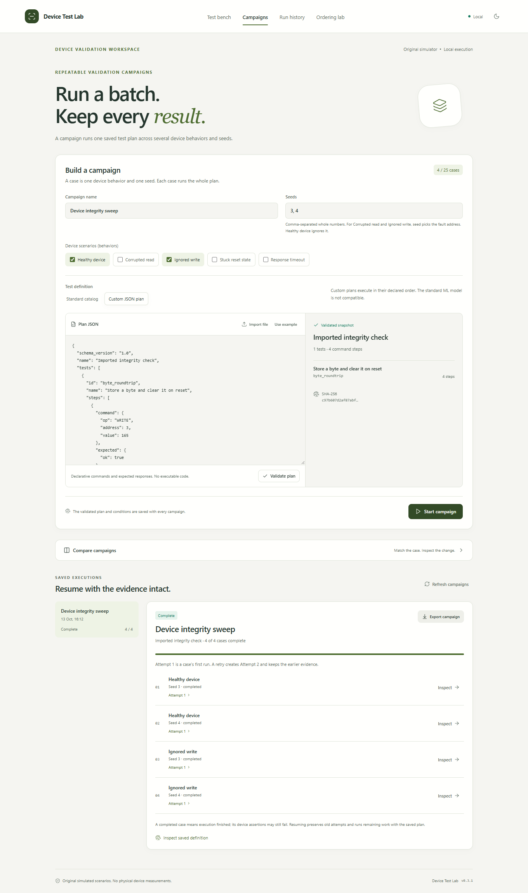
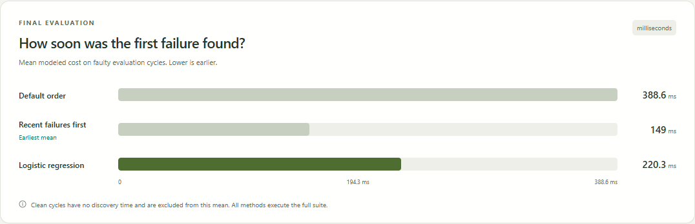

# Device Test Lab

A local workbench for testing a software memory-device simulator, inspecting reproducible fault evidence and comparing ways to order a complete test suite.

The project makes a test result inspectable: choose a simulated device condition, run tests with independent expectations, inspect the command trace and preserve the result. JSON plans extend the test catalog; resumable campaigns repeat conditions; saved-run comparison shows what changed and whether the conditions match. A separate experiment compares logistic regression with catalog order and a simple history rule.


## What it does

- Simulates READ, WRITE, RESET and STATUS over 16 byte-sized memory locations, with five reproducible device scenarios.
- Executes a 14-test catalog or a bounded JSON plan, preserving expected values, actual responses and command traces.
- Separates failed device assertions from runner errors and interrupted work.
- Saves runs in SQLite and exports their evidence as JSON.
- Runs campaigns across scenarios and seeds, with pause after the current run, explicit resumption and preserved retry attempts.
- Compares saved runs while exposing changed conditions, definitions and missing observations.
- Compares campaigns by scenario and seed, using compatible saved attempts and explicit counts for missing or excluded evidence.
- Evaluates three full-suite ordering methods with chronological training, validation and final evaluation.
- Provides light and dark appearance, keyboard controls, narrow layouts and explicit empty, busy and error states.

The simulated memory belongs to an in-process Python object; this application does not test the computer's physical RAM. Modeled milliseconds compare test orders and are separate from measured wall time. The project does not claim physical ATE support, manufacturing coverage or production yield improvement.

## Start on Windows

Install Python 3.12 or later, Node.js 22.12 or later, and pnpm 11. Run these commands from the project folder in PowerShell:

```powershell
python -m venv .venv
.\.venv\Scripts\python.exe -m pip install -r requirements.lock
.\.venv\Scripts\python.exe -m pip install --no-deps -e .
pnpm install --dir frontend --frozen-lockfile
pnpm --dir frontend run build
.\Start.cmd
```

Setup downloads Python packages from PyPI and frontend packages from the npm registry into project environments. Open [the local workbench](http://127.0.0.1:8717) in a browser. On later visits, double-click `Start.cmd`. Press Ctrl+C in the server window to stop it.

If another application uses port 8717, run `Start.cmd --port 8718`. Only one server may own this project's runtime at a time. The launcher binds to the local machine; this repository does not include a public hosting configuration.

The documented setup and verification target Windows. Other operating systems have not been verified. If PowerShell permits local scripts, `scripts/setup.ps1` provides the same setup flow. The direct commands above work without changing script execution policy.

Each checkout starts with empty local history. Screenshots and saved reports show example executions; they are not inserted into a new runtime.

## Try the workflow

1. On **Test bench**, select **Healthy device**, **Catalog order** and seed **3**, then choose **Run tests**. All 14 tests should pass.
2. Select **Corrupted read** with the same seed and run again. Seven tests fail. Open **Single-byte round trip** and compare its expected response, actual response and command trace.
3. Choose **Export JSON** to save that evidence. Open **Run history** to revisit either run.
4. Open **Campaigns**, choose **Custom JSON plan** and import [byte-roundtrip.json](examples/plans/byte-roundtrip.json). Validate the plan, select **Healthy device** and **Ignored write** with seed **3**, then start the campaign.
5. Inspect each case and export the campaign. For longer campaigns, **Pause after current run** and **Resume remaining runs** preserve completed cases. A small simulation may finish before a pause can be requested.
6. In **Run history**, expand **Compare saved runs** and compare two records. Read the condition warnings before interpreting changed verdicts: different scenarios demonstrate fault sensitivity, not an unexplained regression.
7. Open **Ordering lab** and choose **Train and evaluate**. After it finishes, try **ML priority** on the test bench and inspect the model-use or fallback status.

To investigate whole batches, open **Compare campaigns** in Campaigns and select a reference and a comparison. Cases align by scenario and seed. Inspect **Comparable cases** and **Not compared** together, then open the saved observations or export the displayed comparison JSON. Missing work and different definitions stay outside the paired failure counts. The [campaign comparison guide](docs/CAMPAIGN_COMPARISON.md) explains the latest-attempt rules and worked examples.

Custom plans run in their declared order. The standard model is not applied to arbitrary new tests. Campaigns are limited to 25 cases and 50 attempts including retries. See the [API contract](docs/API_CONTRACT.md), [comparison behavior](docs/RUN_COMPARISON.md) and [engineering notes](docs/ENGINEERING_NOTES.md).



## Observed ordering results

The saved experiment contains 210 sequential cycles and 2,940 labeled test outcomes: 120 cycles for training, 30 for validation and 60 for final evaluation. Each final strategy executes all 840 tests and observes the same 210 failing-test outcomes across 45 faulty cycles; 15 cycles are clean.

| Ordering method | Mean modeled cost to first failure on faulty cycles | Mean full-suite modeled cost |
|---|---:|---:|
| Catalog order | 388.578 ms | 1,788.000 ms |
| Recent failures first | **148.956 ms** | 1,788.000 ms |
| Logistic regression | 220.333 ms | 1,788.000 ms |

**The simple history rule won this experiment.** ML improved on catalog order but did not beat the stronger simple comparison. Reordering brought failure evidence forward without reducing full-suite work.



The [experiment method](docs/ML_EXPERIMENT.md) explains the feature boundary, chronological split and fair comparison. The [computed report](docs/results/experiment.json) retains the outcomes and limitations. Training excludes injected fault identity, current outcomes and future information. These results do not establish generalization to a physical test lab.

A [predefined three-seed protocol](docs/ML_ROBUSTNESS_PROTOCOL.md) repeats the evaluation without replacing the original benchmark. The history rule wins all three overall discovery means. Averaged across seed means, catalog order costs 388.804 modeled ms, the rule 172.729 ms and ML 206.589 ms. The [separate report](docs/results/robustness-v1.1.json) includes per-seed and per-regime results. These are descriptive sensitivity results, not a confidence interval.

Reproduce that study in the project environment:

```powershell
.\.venv\Scripts\python.exe -m devicetestlab.ml_robustness --output runtime/robustness-v1.1
```

This command preserves the interactive test bench's model and writes its own seed-specific evidence.

## Verify and contribute

Run the application checks:

```powershell
.\scripts\check.ps1
```

Include the actual browser workflow when Google Chrome is installed:

```powershell
.\scripts\check.ps1 -Browser
```

To use installed Microsoft Edge, set `$env:DTL_BROWSER_CHANNEL = 'msedge'` before the browser checks. The checks use isolated temporary runtimes and headless browser profiles. If script execution is blocked, [CONTRIBUTING.md](CONTRIBUTING.md#validation) lists direct commands.

The [verification record](docs/VERIFICATION.md) distinguishes earlier implementation checks from checks of the current distribution. The [interface notes](docs/design/README.md) describe the rendered states and visual conventions.

## Project map

| Path | Responsibility |
|---|---|
| `backend/devicetestlab/device.py` | Device behavior and controlled faults |
| `backend/devicetestlab/engine.py` | Test definitions, independent assertions and evidence |
| `backend/devicetestlab/plans.py` | Strict JSON validation and custom-plan execution |
| `backend/devicetestlab/campaigns.py` | Campaign state, explicit resumption and retry attempts |
| `backend/devicetestlab/comparison.py` | Condition-aware comparison of preserved observations |
| `backend/devicetestlab/campaign_comparison.py` | Scenario-and-seed alignment of saved campaign attempts |
| `backend/devicetestlab/storage.py` | Transactional SQLite records |
| `backend/devicetestlab/app.py` | Local API, shared worker and frontend serving |
| `backend/devicetestlab/ml_service.py` | History features, training, ordering and evaluation |
| `frontend/src/` | React and TypeScript interface |
| `tests/` and `scripts/` | Verification, setup and launch tooling |
| `runtime/` | Generated local history and models, ignored by Git |

The project is licensed under the [MIT License](LICENSE), copyright 2026 lejie710. [Third-party foundations](docs/THIRD_PARTY.md) describes the dependencies and the separate [shadcn/ui notice](THIRD_PARTY_NOTICES.md).

Developed with assistance from AI tools.
