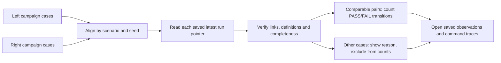

# Compare two saved campaigns

Campaign comparison answers a bounded question: for scenario/seed conditions present in both campaigns, which recorded PASS/FAIL observations changed when the saved definitions and engine context match? It reads existing evidence, aligns cases by condition, then opens the existing detailed run comparison for each pair. It does not execute tests or infer a cause.

## Use the comparison

1. Open **Campaigns** and locate the campaign comparison panel. Select the left campaign as the earlier reference and the right campaign as the later observation.
2. Select **Compare campaigns**. Read the condition warnings before interpreting any count. A different saved definition or engine fingerprint changes what the observations mean.
3. Check **Comparable cases** and **Not compared** together. Missing cases, incomplete work and unverified definitions do not enter the paired denominator.
4. Inspect a case to see both latest attempts and the saved test observations. Expected responses, actual responses and command traces explain the recorded verdict; the count alone cannot do that.
5. Use **Export comparison JSON** to save the displayed report. It includes condition checks, exclusion reasons, attempt references and both sides of the available test evidence.

The left/right direction matters: every delta is right minus left. Selecting the same saved campaign cannot create independent evidence. The API returns an explicit warning and no compared counts for that selection.

## What is a matching case?

Each campaign case represents one scenario and one seed. The pair `(scenario, seed)` identifies the same conditions across campaigns; a case's position or generated ID does not. A reordered case list therefore does not change which runs are paired. A condition that exists only on the right is added, and one that exists only on the left is removed.

A retry remains a separate run. Comparison follows the case's explicit `run_id`, checks that it matches the final saved attempt, and verifies ownership and conditions. If that latest run is missing, pending or interrupted, an earlier successful attempt does not silently replace it. All earlier attempt IDs remain visible for inspection through the campaign's existing history.

## Read the denominator before the delta

Suppose two saved campaigns contain these illustrative case states:

| Scenario and seed | Left latest attempt | Right latest attempt | Treatment |
|---|---|---|---|
| `healthy`, 3 | Complete, matching definition | Complete, matching definition | Compared |
| `ignored_write`, 3 | Complete, matching definition | Complete, matching definition | Compared |
| `healthy`, 4 | Complete | Interrupted retry | Not compared |
| `timeout`, 3 | Complete | No such case | Removed, not compared |
| `healthy`, 9 | No such case | Complete | Added, not compared |

There are five aligned conditions, three matching conditions, two comparable cases and three not-compared cases. If each comparable run contains four tests, the observation denominator is eight paired tests. The other cases contribute zero observations to those eight; they are not counted as passes or failures.

For a second illustrative example, one comparable four-test pair could contain:

| Test | Left | Right | Category |
|---|---|---|---|
| A | PASS | FAIL | New failure |
| B | FAIL | PASS | Resolved failure |
| C | FAIL | FAIL | Persistent failure |
| D | PASS | PASS | Unchanged pass |

The failure total is two on each side and the failure-count delta is zero. Nevertheless, two test verdicts changed. This is why the report retains transition categories and detailed evidence instead of treating a zero aggregate delta as an unchanged result. This example illustrates the arithmetic; it is not a measured regression in this simulator. Identical definitions, scenario and seed normally produce deterministic verdicts here.

The four transition counts always sum to `compared_tests`. `changed_cases` and `unchanged_cases` sum to `comparable_cases`. A case with one new and one resolved failure contributes to both `new_failure_cases` and `resolved_failure_cases`, so those two counts must not be added to obtain a unique case count.

## Why a case may be excluded

| Status | Meaning | What remains inspectable |
|---|---|---|
| `compared` | Independent, completed runs with matching saved context | Transition counts and full run evidence |
| `incomparable` | Different or unavailable definitions/engine context, incomplete test observations, or the same campaign selected twice | Recorded observations and condition warnings |
| `incomplete` | The latest case or run is pending, running, interrupted or in runner error | Saved partial observations and exact state |
| `missing_run` | The latest pointer names a run absent from storage | The pointer and preserved attempt IDs |
| `invalid_link` | Ownership, latest pointer, attempt number, definition membership or another integrity check disagrees | Available recorded metadata and explicit mismatch warnings |
| `added` | Condition exists only in the right campaign | The right case and any available latest run |
| `removed` | Condition exists only in the left campaign | The left case and any available latest run |

The existing saved-run comparison adds its own checks for test membership, duplicate test IDs, saved command/expectation changes and complete PASS/FAIL observations. A completed campaign flag alone cannot establish these facts. Conversely, a paused or interrupted campaign may still contain completed comparable cases; those cases can be compared while its unfinished cases remain excluded.

Different scenarios deliberately inject different fault behavior. They become different case conditions, not a claimed regression. Different definitions remain visible but outside comparison counts even if their test IDs or display names happen to match. Missing historical engine metadata is reported as unverified, never replaced with today's fingerprint.

## Saved views and exports

The UI export saves the exact displayed response. If a campaign is still active, refresh the comparison to read its newer state. A direct request to `GET /api/campaign-compare/export?left=...&right=...` computes a fresh report, so it may differ from a report displayed before an active campaign advanced. Each request reads each selected latest run once; completed runs remain immutable.

The JSON report contains campaign summaries, conditions, warnings, precise summary counts and per-case records. For available run pairs it also contains the existing full run comparison, including test observations and traces. It references earlier attempts by ID; it is not a replacement for **Export campaign**, which includes every attempt's full original run record. No CSV export or history mutation is introduced.

## Trace the implementation

`backend/devicetestlab/campaign_comparison.py` performs alignment, attempt checks, aggregation and route registration. `comparison.py` remains the source of the detailed two-run comparison. `app.py` registers the new read-only routes without changing the shared worker or execution flow. `tests/test_campaign_comparison.py` covers reordered and changed case sets, definition changes, latest retries, incomplete and missing evidence, broken links, same-campaign selection, precise transition counts and byte-for-byte persistence preservation.

The report describes software-simulation observations. It does not establish physical-device behavior, cause, statistical significance or a universal acceptable failure threshold. Timing remains contextual: modeled work and laptop wall time have different meanings, as explained in the saved-run comparison.
