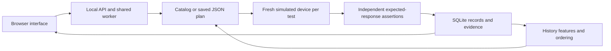

# Engineering notes

Device Test Lab models a small device-test system whose results remain inspectable after execution. The application runs locally and uses synthetic faults; it has no physical-device adapter, remote device control, authentication system or hosted service.

## Execution and evidence

The simulator implements WRITE, READ, RESET and STATUS. Controlled scenarios change device behavior. The runner asserts independently defined expected responses and saves actual responses and the command trace. Assertions establish PASS or FAIL; execution errors are recorded separately. A failure does not stop the remaining tests in a complete suite.

Each test uses a fresh device state, so changing its position does not alter its meaning. Seeds reproduce fault choices. Modeled command costs allow deterministic ordering comparisons without artificial delays; actual elapsed time is a separate measurement.

## Plans and campaigns

Custom plans are bounded JSON data with strict fields and response assertions. They do not execute supplied source code. Validation returns a normalized snapshot and fingerprint. An earlier run retains that snapshot even after the editor changes.

Campaigns save a scenario-and-seed case matrix and plan snapshot. Limits are 25 cases and 50 attempts including retries. Standalone runs, campaigns and model fitting share one worker, so conflicting work is rejected rather than racing over runtime state.

Pause takes effect after a complete run. Startup recovery records interrupted work and waits for explicit resumption. Completed cases remain complete; a retry creates a new attempt with fresh device state. The run and campaign-attempt link are committed together. Resumption rejects an incompatible engine source fingerprint or standard definition snapshot; this conservative check does not infer semantic equivalence from edited source.

See the [API contract](API_CONTRACT.md) for exact fields and limits.

## Persistence and interpretation

SQLite preserves earlier run snapshots and attempts. An operating-system lock prevents a second server from owning the same runtime and applying recovery while the first server is active. Migrations must retain existing evidence, including older records whose provenance fields are absent.

Run comparison presents the conditions before the changed results. It checks scenario, seed, definitions, engine context, test membership and completeness. Different ordering remains explainable because tests start from isolated state. Missing provenance is reported as unverified; it is not replaced with current metadata. See [comparison behavior](RUN_COMPARISON.md).

## Ordering experiment

The ordering model schedules tests; it never changes assertions or skips work. Features are frozen from prior completed history. Injected fault identity, current responses, current labels and future observations stay outside the features. Training, validation and final evaluation use chronological complete-run cohorts.

Every compared method executes the same full suite under equivalent conditions and history. The main metric is modeled cost to the first observed failing test. A clean cycle has no first failure and is excluded from that average, with its count reported separately. Complete-suite cost and equivalent outcomes are checked alongside discovery cost.

The saved results favor the simple history rule over logistic regression. Preserve that outcome and the boundary between synthetic evidence and unmeasured physical-device benefit. Read the [experiment method](ML_EXPERIMENT.md) and [three-seed protocol](ML_ROBUSTNESS_PROTOCOL.md) before changing evaluation.

## Runtime and validation boundaries

The documented Windows launcher serves only on loopback. Local files under `runtime/` contain generated history and models. The model is an inspectable JSON parameter file; the browser does not accept arbitrary executable model uploads.

Checks use separate runtime folders and headless browser profiles. The bounded command helper cleans up only its assigned process tree. A timeout or runner error must remain distinguishable from an intentional failing device scenario. The [verification record](VERIFICATION.md) states what was actually exercised and what remains unverified.
