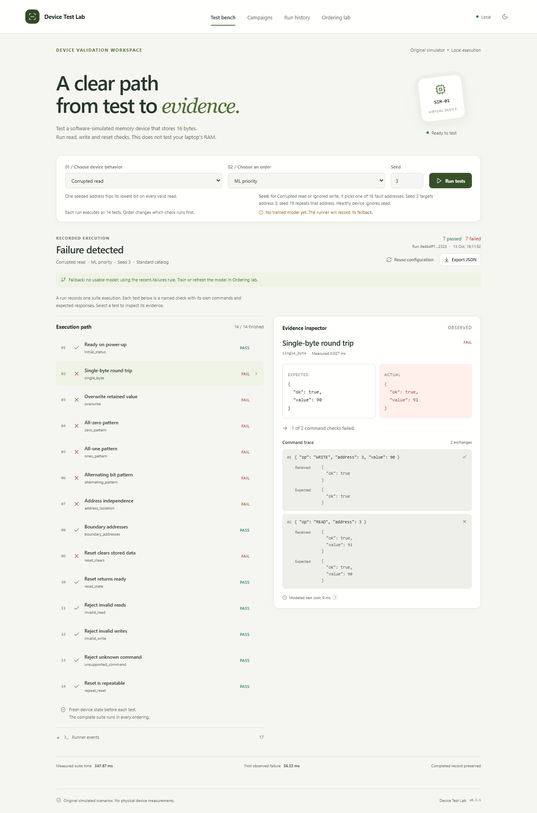
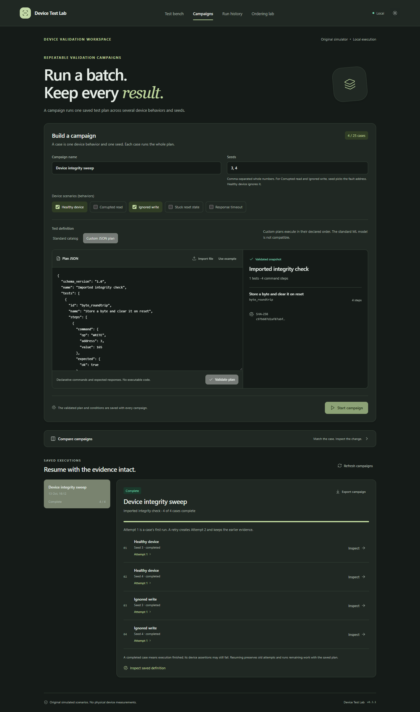

# Studio interface

The interface keeps configuration, execution and evidence in one workflow. Top navigation separates Test bench, Run history, Campaigns and Ordering lab. Wide layouts place evidence beside the execution path; narrow layouts stack the same content.

Warm neutral surfaces and olive accents provide the default light appearance. Dark appearance keeps the same hierarchy. Status labels and expected/actual text carry the result meaning alongside color. The interface uses system fonts and does not fetch remote font files.

## Interface behavior

- Keep the current conditions visible when starting or reviewing a run.
- Show the actual model-use or fallback status where ordering is selected.
- Present expected responses, observed responses and command traces together.
- Keep runner errors, device failures, interruption and pending work distinct.
- Show comparison conditions before changed verdicts.
- Use clear empty, loading, busy, validation-error and unavailable-API states.
- Preserve keyboard access, visible focus, readable contrast and reduced-motion preferences.
- Keep the same useful evidence available on narrow screens.

Screenshots in `docs/screenshots/` are recorded application states with synthetic data. The production interface must render API observations; demonstration images are not data sources.

## Implementation and review

React and Vite provide the application shell. The Button component follows the shadcn/ui composition pattern with Radix Slot and Class Variance Authority. Preserve the existing layout vocabulary when adding workflows, and use motion only when it explains a state change or answers a user action.

Review actual rendered states in both appearances and a narrow layout. Automated browser checks cover the main execution, campaign, comparison and offline paths; inspect changed states visually as well. See [verification](../VERIFICATION.md) for the executed coverage and [third-party foundations](../THIRD_PARTY.md) for component provenance.
